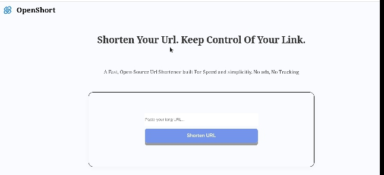
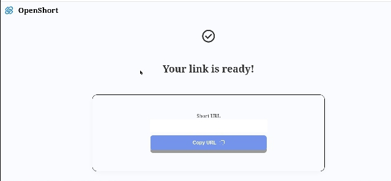

# OpenShort

An open-source, self-hosted URL shortener built with Go. it's lightweight enough to run on a tiny Linux machine, so you can own your short links instead of paying for a monthly subscription service.

## Feature

- Landing page with a URL field and empty-input validation
- Result page that shows the original URL and a copy button
- Go web server that serves the static site
- Random 6-character code generator
- In-memory store for code -> URL, protected by a mutex
- Short URL generation
- Redirect URL To original Url with short URL


## Tech Stack

- HTML, CSS, JavaScript, and Go


## Preview 





## Requirements
```
-Go installed
```
## Installation

### Clone Repository
```
git clone https://github.com/Zarrr-Dev/OpenShort.git
```

### Enter the folder
cd OpenShort


### Running go
go run main.go

### Open The Aplication
http://localhost:8080

## Structure Folder
```
OPENSHORT/
├── static/
|   ├── assets/
|   |   ├── logo.png
|   |
|   ├──docs/
|   |  ├──dashboard.png
|   |  ├──page2.png
|   |  
|   ├── 404.html
|   ├── detail.html
|   ├── index.css
|   ├── index.html
|   ├── index.js
|   ├── ready.html
|   ├── ready.js
├── go.mod
├── main.go
├── README.md
```

🚧 Project Status

In Progress — OpenShort is currently under development.