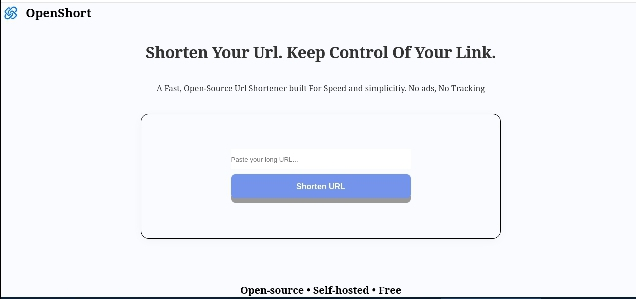
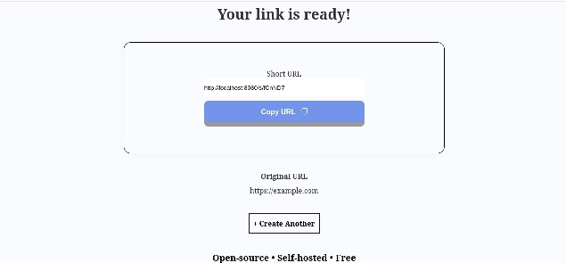
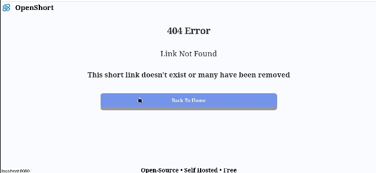

# OpenShort
An open-source, self-hosted URL shortener built with Go. it's lightweight enough to run on a tiny Linux machine, so you can own your short links instead of paying for a monthly subscription service.

## Feature

- Landing page with URL field and empty-input validation.
- URL format validation (http/https with host).
- Result page with short URL and original URL.
- Copy button with "Coppied!" feedback.
- Redirect /s/<code> to original URL.
- Custom 404 page for unknown codes.
- Random 6 chracter code generator.
- Store code -> URL in memory, presited to data.json.
- History page, latest 10 items, saved in localStorage.
- Delete history shortenes URL(browser only).


## Tech stack
- HTML, CSS, JavaScript, and Go.

## Preview 





## Requirements
```
Go 1.27.1
```
## Installation

### Clone repository
```
git clone https://github.com/Zarrr-Dev/OpenShort.git
```

### Enter the folder
```
cd OpenShort
```
### Run the server
```
go run main.go
```
### Open the application
```
http://localhost:8080
```
## Structure folder
```
OPENSHORT/
├── static/
|   ├── assets/
|   |   ├── logo.png
|   |
|   ├──docs/
|   |  ├──Dashboard.png
|   |  ├──Ready-Page.png
|   |  ├──404-Page.png
|   |  
|   ├── 404.html
|   ├── history.html
|   ├── history.js
|   ├── index.css
|   ├── index.html
|   ├── index.js
|   ├── ready.html
|   ├── ready.js
|
├── .gitignore
├── go.mod
├── main.go
├── README.md
```

## Demo link
```
https://openshort-production.up.railway.app/
```
## 🚧 Project Status
MVP: Shortening and Redirect work.